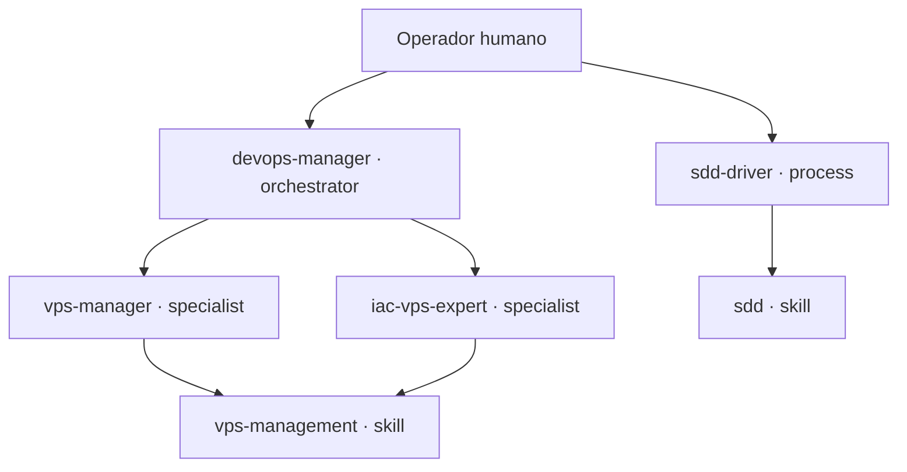

# Organización de agentes (organigrama)

## Propósito

Este documento define la jerarquía de agentes del Workbench: los niveles de
responsabilidad, las reglas de delegación y el checklist de onboarding para
incorporar un agente o subagente nuevo. Es la fuente de verdad del organigrama
(ADR-0005) y complementa [architecture.md](architecture.md) y
[conventions.md](conventions.md).

## Modelo de roles

Los agentes se organizan en tres niveles de responsabilidad más una capa de
conocimiento que no son agentes.

### Nivel 0 — Orquestadores (`role: orchestrator`)

- **`mode`**: `primary` (o `all`).
- Deciden qué se hace, en qué orden y quién lo ejecuta. Delegan la ejecución
  en especialistas y no ejecutan operaciones sensibles directamente.
- **Repertorio**: [devops-manager](../workflows/agents/devops-manager.md).

### Nivel 1 — Procesos (`role: process`)

- **`mode`**: `all`.
- Ejecutan un proceso transversal completo (p. ej. SDD) y lo validan.
- **Repertorio**: [sdd-driver](../workflows/agents/sdd-driver.md).

### Nivel 2 — Especialistas (`role: specialist`)

- **`mode`**: `subagent` (o `all`).
- Ejecutan un dominio concreto cargando los skills de su ámbito.
- **Repertorio**: [vps-manager](../workflows/agents/vps-manager.md),
  [iac-vps-expert](../workflows/agents/iac-vps-expert.md),
  [opencode-expert](../workflows/agents/opencode-expert.md).

### Capa de conocimiento (skills)

No son agentes: aportan conocimiento reutilizable que los agentes cargan
durante su trabajo. Viven en `core/` (universal) o `technologies/`
(específicos de tecnología). La relación agente → skill se declara en el campo
`skills` del frontmatter del agente.

## Diagrama

## Matriz de delegación

| Agente | role | mode | Delega en | Skills |
| --- | --- | --- | --- | --- |
| [devops-manager](../workflows/agents/devops-manager.md) | orchestrator | primary | `vps-manager`, `iac-vps-expert` | — |
| [sdd-driver](../workflows/agents/sdd-driver.md) | process | all | — | `sdd` |
| [vps-manager](../workflows/agents/vps-manager.md) | specialist | all | — | `vps-management` |
| [iac-vps-expert](../workflows/agents/iac-vps-expert.md) | specialist | all | — | `vps-management` |
| [opencode-expert](../workflows/agents/opencode-expert.md) | specialist | subagent | — | — |

## Fronteras entre agentes

- **`devops-manager` vs `plan` (built-in)**: `plan` planifica tareas genéricas;
  `devops-manager` solo decide y orquesta el ámbito de infraestructura/entornos
  del operador. Como es `mode: primary`, se selecciona en el TUI; `plan`/`build`
  no pueden delegarle.
- **`vps-manager` vs `iac-vps-expert`**: la frontera es *runtime* vs *código
  declarativo*. `vps-manager` opera el servidor (desplegar, reiniciar, SSL,
  logs, backups); `iac-vps-expert` escribe y valida Ansible/compose/Makefile y
  no ejecuta `up`/`down` en producción.

## Reglas de coherencia role ↔ mode

| role | modes permitidos |
| --- | --- |
| `orchestrator` | `primary`, `all` |
| `process` | `all` |
| `specialist` | `subagent`, `all` |

## Checklist de onboarding de un agente

Antes de crear un agente o subagente nuevo:

1. **¿Agente o skill?** Si solo aporta conocimiento, crea un skill en `core/`
   o `technologies/`; no un agente.
2. **Nivel**: ¿decide y delega? → `orchestrator`. ¿Ejecuta un proceso
   transversal? → `process`. ¿Ejecuta un dominio? → `specialist`.
3. **`mode`** coherente con el `role` (tabla anterior).
4. **Nombre**: kebab-case, en inglés, descriptivo
   ([conventions.md](conventions.md)).
5. **Frontmatter completo**: `name`, `type: agent`, `version`, `status`,
   `purpose`, `tags`, `mode`, `role`, `description`; y opcionalmente `model`,
   `temperature`, `permission`, `delegates_to` y `skills`. Usa la plantilla
   [workflows/templates/agent.md](../workflows/templates/agent.md).
6. **Delegación**: si delega, declara `delegates_to` con agentes existentes.
7. **Conocimiento**: si carga skills, declara `skills` existentes en `core/`
   o `technologies/`.
8. **Documentación**: añade el agente a la matriz de este documento y al
   repertorio de [usage.md](usage.md).
9. **Validación**: ejecuta `./workflows/commands/check-consistency.sh` hasta
   obtener 0 FAIL.
10. **Commit**: el hook de pre-commit vuelve a ejecutar la validación.

## Ciclo de vida

Los agentes siguen el ciclo de vida general del Workbench
([roadmap.md](roadmap.md), ficha 9): `draft → experimental → stable →
deprecated → archived`. La transición a `stable` o `deprecated` requiere
revisión explícita.

## Relaciones

- [architecture.md](architecture.md) — responsabilidad de los agentes.
- [conventions.md](conventions.md) — frontmatter y reglas de los agentes.
- [usage.md](usage.md) — instalación y repertorio por nivel.
- [decisions/0005-agent-organization-governance.md](decisions/0005-agent-organization-governance.md)
  — decisión arquitectónica.
